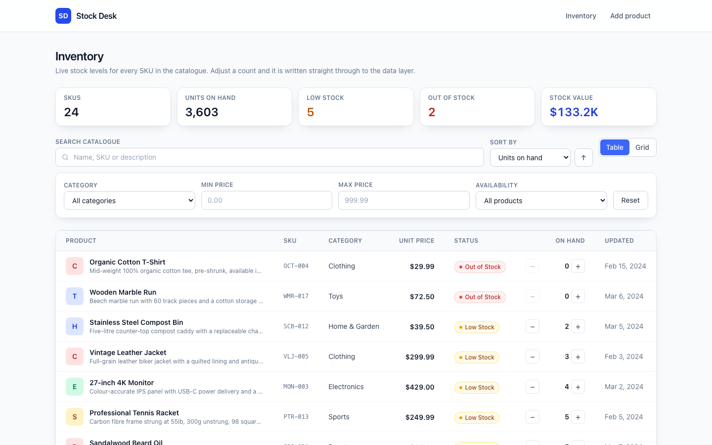
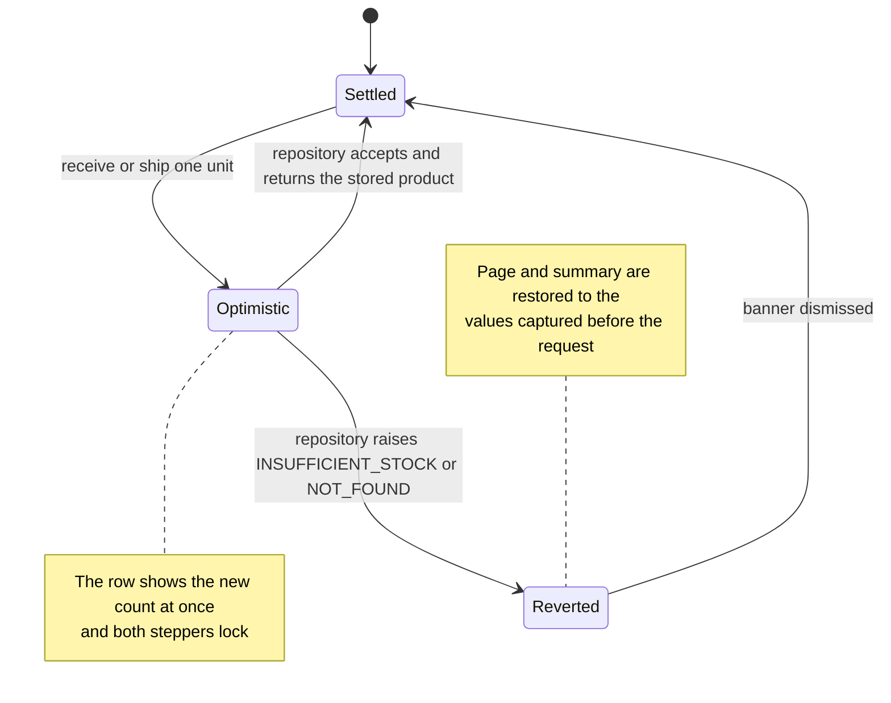
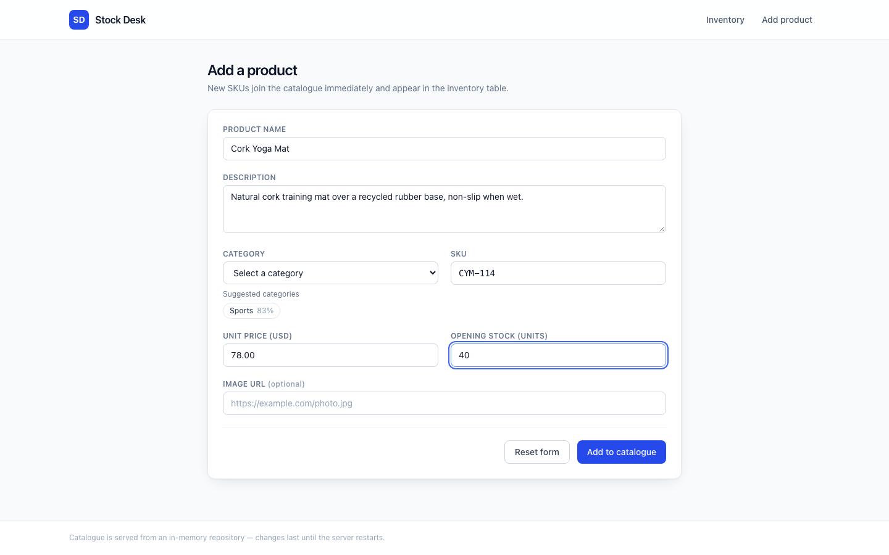
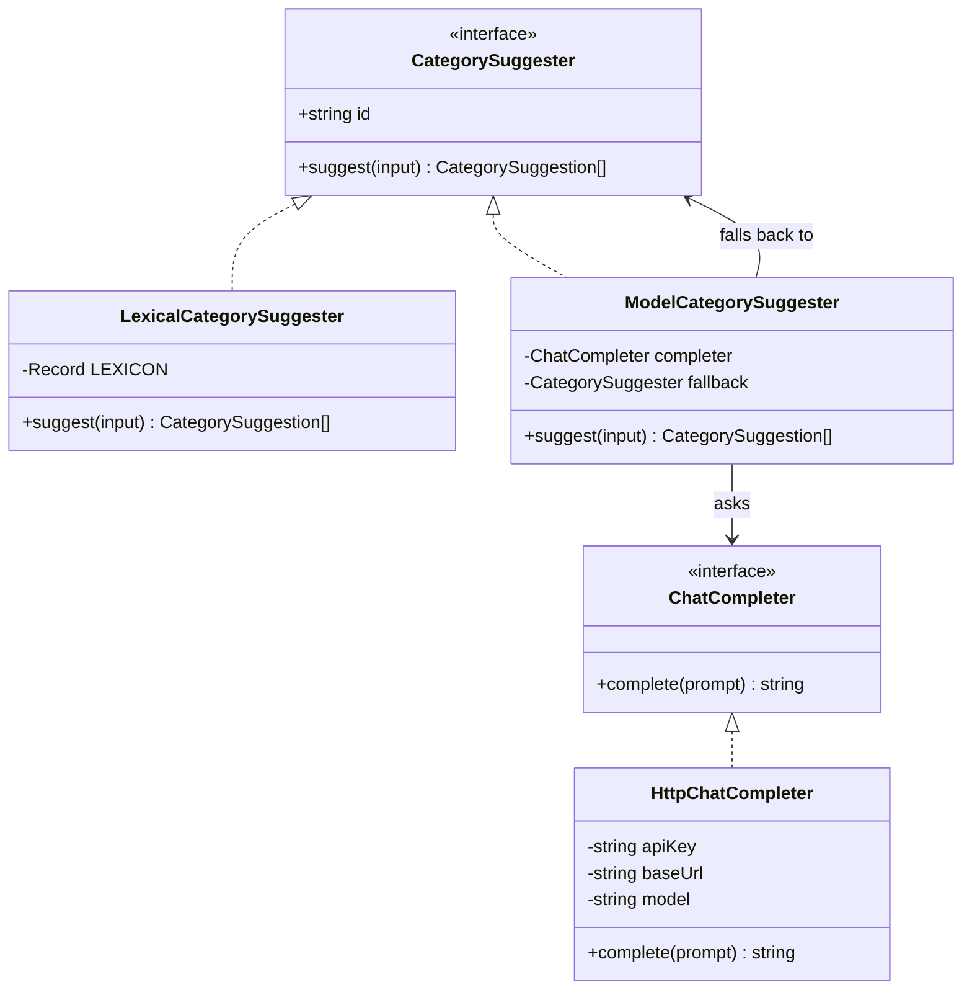

# Stock Desk

A single-screen inventory desk for a small product catalogue. It shows what is on hand,
puts the SKUs that need a buyer's attention at the top, and lets you receive or ship a
unit without leaving the row.



Built with Next.js 15 (App Router), React 18, TypeScript and Tailwind. The catalogue is
served by an in-memory repository, so the app runs with no database and no API key.

## Run it

```bash
npm install
npm run dev          # http://localhost:3000
```

Other commands:

```bash
npm test             # Jest + React Testing Library
npm run type-check   # tsc --noEmit
npm run lint         # next lint
npm run format       # prettier --write .
npm run build        # production build (standalone output)
```

Node 20 or newer. No environment variables are required; `.env.example` lists the three
optional ones.

## What is on the screen

The header tiles count the **whole** catalogue, not the filtered page, so narrowing the
table does not make the business look smaller than it is. On the seeded catalogue they
read 24 SKUs, 3,603 units on hand, 5 low stock, 2 out of stock.

Rows are sorted by units on hand ascending by default — an inventory screen should open
on the problems. A SKU is **Out of Stock** at zero and **Low Stock** at or below the
reorder point of 5 units (`src/config/app.ts`). Both thresholds come from one function,
`classifyStock`, so a badge and a filter can never disagree about what "low" means.

Above the table: a search box over name, SKU, description and category, debounced by
250 ms so a typed word costs one read rather than one per keystroke; sort by name, price,
units or last-updated; and a table/grid toggle. Below it: category, price-range and
availability filters, and pagination at eight rows a page.

Quantities and prices both go through `Intl` (`src/utils/formatters.ts`). A four-digit
count renders as `1,240`, not `1240`.

## Adjusting stock without a spinner

The `−` and `+` buttons in each row write straight through. The row updates before the
request resolves, and if the data layer refuses the change, the previous row _and_ the
summary tiles are put back exactly as they were, with the reason shown in a banner.



The refusal is a real one, not a simulated failure: `adjustStock` rejects any change that
would take a count below zero, so shipping 50 units of a SKU with 10 on hand raises
`INSUFFICIENT_STOCK` and the row snaps back. Three tests in
`__tests__/hooks/useInventory.test.tsx` cover the accept path, the rollback and the
summary restore.

## Where the rules live

```
src/
  config/app.ts        every tunable: locale, reorder point, page size, latency, debounce
  domain/stock.ts      what a stock number means — the only place a threshold is compared
  domain/query.ts      filter, search, sort, page and summarise, over a plain array
  lib/repository.ts    ProductRepository interface + the in-memory adapter
  lib/api.ts           thin facade the UI imports — never an adapter directly
  lib/ai/              category suggestion port and its adapters
  hooks/               useInventory (query, page, optimistic writes), useDebouncedValue
  components/          table, grid card, filters, toolbar, badges, pagination, states
  app/                 routes: /, /products, /api/health, /api/suggest-category, 404
```

Three things follow from that split:

- **Filtering is defined once.** `matchesQuery` is the only predicate in the codebase. The
  repository calls it; nothing in the UI re-implements it. A filter cannot mean two
  different things in two files.
- **Reads hand out copies.** `InMemoryProductRepository` clones on the way out, so a
  component that mutates a product it was given cannot corrupt the catalogue. There is a
  test for exactly that.
- **The backend is swappable.** Everything above `ProductRepository` is written against
  the interface. `setProductRepository` exists so the test suite can hand the facade a
  fresh fixture per test instead of inheriting writes from the previous one.

## Suggesting a category

Typing a name and description on **Add product** proposes categories with a confidence
score. It is advisory — the select is still the field of record and the form submits fine
if you ignore it.





With no `AI_API_KEY` set — the default — `createCategorySuggester` returns
`LexicalCategorySuggester`, which scores each category by how many of its terms appear in
the text, weighting a name match double. It is offline and deterministic: the same input
gives the same answer on every run, and there is a test asserting that.

Set `AI_API_KEY` (plus an optional `AI_BASE_URL` and `AI_MODEL` for any OpenAI-compatible
endpoint) and `ModelCategorySuggester` takes over. It constrains the model to the eight
catalogue categories, and on _any_ failure — timeout, HTTP error, unparseable reply, a
category that does not exist — it returns the lexical answer instead of an error. The
call happens in a route handler, so the key never reaches the browser.

## The catalogue

`src/data/mockProducts.ts` seeds 24 SKUs across the eight categories. The mix is
deliberate: two sit at zero, four sit at or under the reorder point, and one carries
four-digit cover, so every stock state and the thousands separator are visible on the
first screen without editing any data.

Writes land in process memory. They survive navigation but not a server restart.

`GET /api/health` reports liveness and reads through the data layer:

```json
{ "status": "ok", "catalogue": { "skuCount": 24, "unitCount": 3603 } }
```

## Tests

```bash
npm test
```

**116 tests across 13 suites, all passing.** They cover the stock classifier and its
boundaries, the query predicate (price bounds are inclusive, both directions of the
availability filter, search across SKU), sorting and paging, the repository's validation
and its refusal to oversell, the optimistic-write rollback, the category suggester and
its fallback, and the table, filter, toolbar and pagination components.

## Container

```bash
docker compose up --build     # http://localhost:3000
WEB_PORT=8080 docker compose up --build
```

The image is a three-stage build on `node:22-alpine`: install, build, then a runtime stage
that copies only Next's standalone server output and runs as an unprivileged `nextjs`
user. `docker compose config` validates. The image has **not** been built or booted on
this machine — Docker Desktop is off here — so treat the Dockerfile as reviewed, not
proven.

## Things this does not do

- **The catalogue is in-memory.** Restarting the server resets every write. The
  `ProductRepository` interface is the seam a real backend would slot into.
- **No pagination server-side.** `queryProducts` filters and slices a plain array. That is
  honest for 24 rows and wrong for 24,000 — the page window and total are already in the
  response shape, so the change is contained to the adapter.
- **No row virtualisation.** Eight rows a page keeps the DOM small instead.
- **No editing or deleting from the table.** The repository supports `update` and `remove`
  and both are tested, but the only write wired to the UI is the one-unit stock
  adjustment.
- **The grid card's "Add to Cart" and "Details" buttons are stubs** that log to the
  console. The grid is a merchandising preview, not a storefront.
- **No auth.** Anyone who can reach the app can change stock levels.

## Running check

The production build was opened on the products screen, and its category endpoint
returned a lexical suggestion without a model key.
[Native products view](docs/screenshots/native-products.png) ·
[Verification record](docs/native-verification.json). Use Node.js 22.12 or newer.
