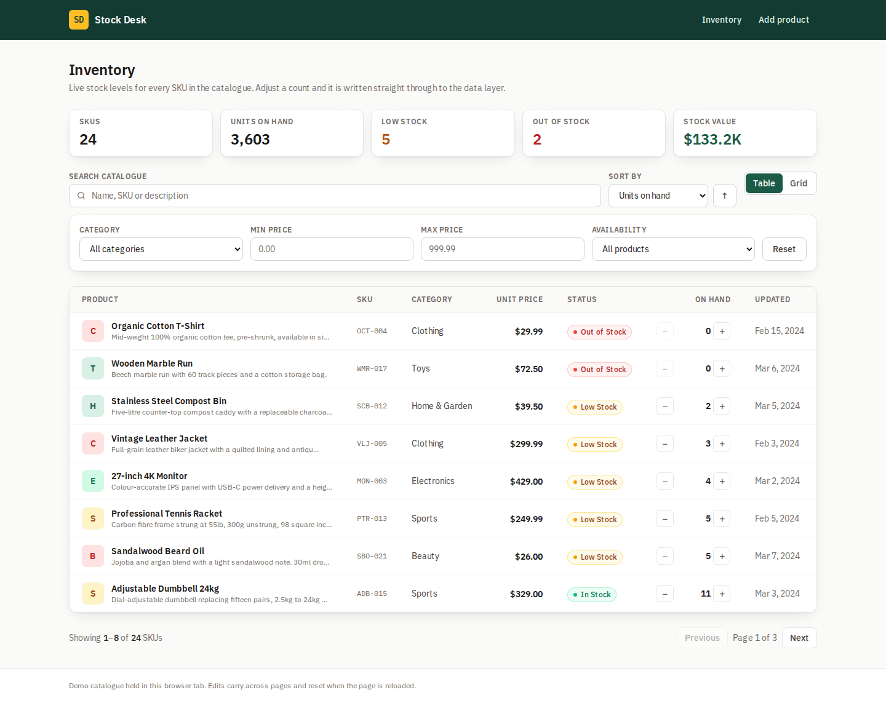
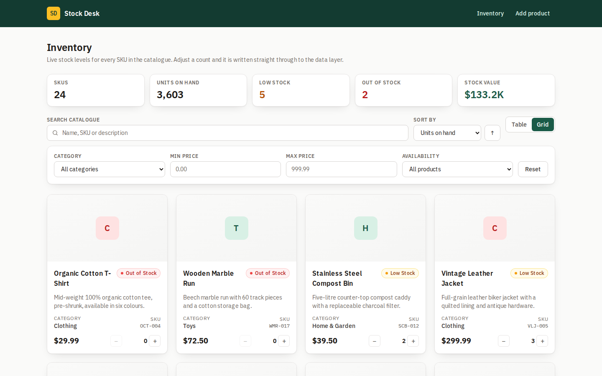
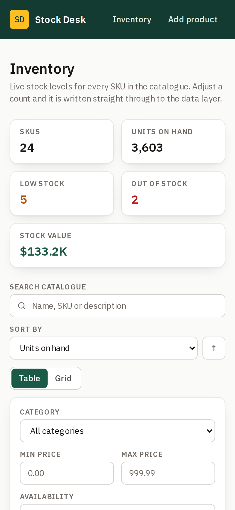
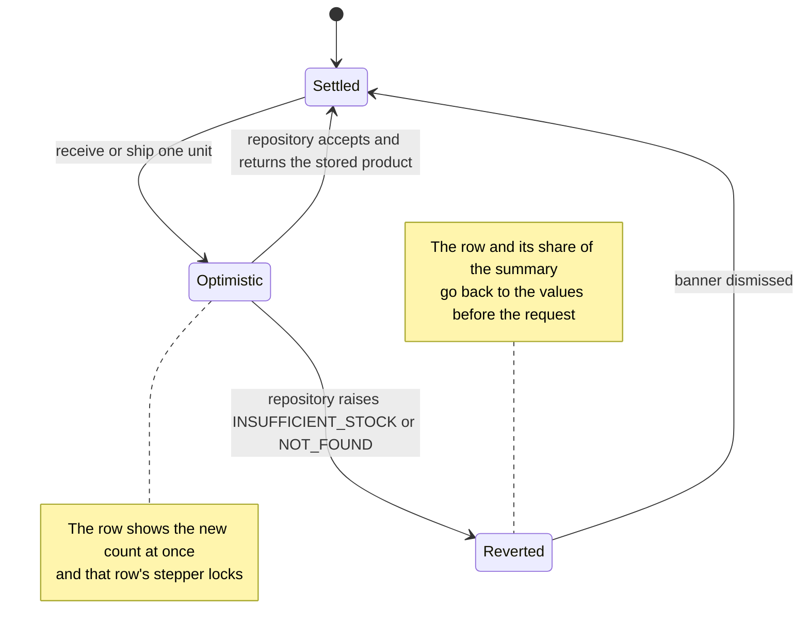
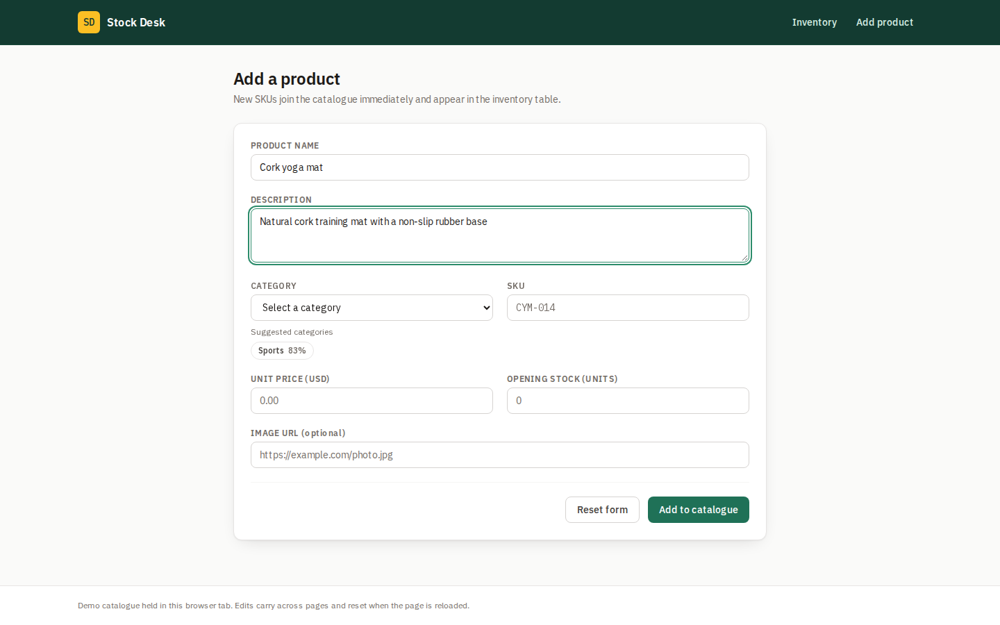
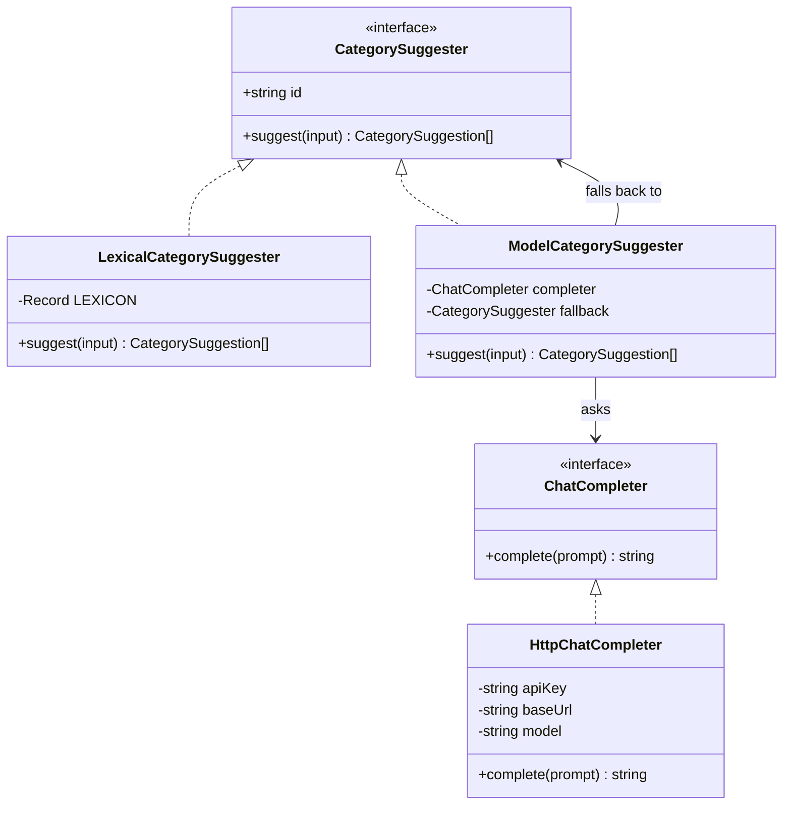

# Stock Desk

A single-screen inventory desk for a small product catalogue. It shows what is on hand,
puts the SKUs that need a buyer's attention at the top, and lets you receive or ship a
unit without leaving the row.



Built with Next.js 15.5 (App Router), React 19, TypeScript, Tailwind 3 and zod 4. The
catalogue is an in-memory demo repository, so the app runs with no database and no API
key.

## Run it

With Docker, nothing else installed:

```bash
docker compose up --build     # http://localhost:3000
```

Or with Node 22 (`.nvmrc`):

```bash
npm ci
npm run dev                   # http://localhost:3000
```

Other commands:

```bash
npm test             # Jest + React Testing Library
npm run type-check   # tsc --noEmit
npm run lint         # ESLint 9, flat config in eslint.config.mjs
npm run format       # prettier --write .
npm run build        # production build (standalone output)
```

No environment variables are required; `.env.example` lists the three optional ones. The
build downloads IBM Plex once through `next/font`, which then serves it from the app
itself, so `npm run build` and the Docker build need network access to Google Fonts.

## What is on the screen

The header tiles count the **whole** catalogue, not the filtered page, so narrowing the
table does not make the business look smaller than it is. On the seeded catalogue they
read 24 SKUs, 3,603 units on hand, 5 low stock, 2 out of stock.

Rows are sorted by units on hand ascending by default — an inventory screen should open
on the problems. A SKU is **Out of Stock** at zero and **Low Stock** at or below the
reorder point of 5 units (`src/config/app.ts`). Both thresholds come from one function,
`classifyStock`, so a badge and a filter can never disagree about what "low" means.

Above the table: a search box over name, SKU, description and category, debounced by
250 ms so a typed word costs one read rather than one per keystroke; sort by name, price,
units or last-updated; and a table/grid toggle. Below it: category, price-range and
availability filters, and pagination at eight rows a page. The grid shows the same page as
cards, each with the same receive/ship stepper as its table row.



On a phone the summary tiles and filters fold into two columns and the table scrolls
sideways inside its own frame rather than the page.



Quantities and prices both go through `Intl` (`src/utils/formatters.ts`). A four-digit
count renders as `1,240`, not `1240`.

## Adjusting stock without a spinner

The `−` and `+` buttons in each row write straight through. The row updates before the
request resolves, and if the data layer refuses the change, that row _and_ its share of
the summary tiles are put back, with the reason shown in a banner. Only the refused row is
reverted: a write on another row that landed in the meantime stays.



The refusal is a real one, not a simulated failure: `adjustStock` rejects any change that
would take a count below zero, so shipping 50 units of a SKU with 10 on hand raises
`INSUFFICIENT_STOCK` and the row snaps back. Tests in
`__tests__/hooks/useInventory.test.tsx` cover the accept path, the rollback, the summary
restore and a refusal that arrives after a write on another row has already succeeded.

## Where the rules live

```
src/
  config/app.ts        every tunable: locale, reorder point, page size, latency, debounce
  domain/stock.ts      what a stock number means — the only place a threshold is compared
  domain/query.ts      filter, search, sort, page and summarise, over a plain array
  lib/repository.ts    ProductRepository interface + the in-memory adapter
  lib/api.ts           thin facade the UI imports — never an adapter directly
  lib/ai/              category suggestion port and its adapters
  hooks/               useInventory (query, page, optimistic writes), useDebouncedValue
  components/          table, grid card, filters, toolbar, badges, pagination, states
  app/                 routes: /, /products, /api/health, /api/suggest-category, 404
```

Three things follow from that split:

- **Filtering is defined once.** `matchesQuery` is the only predicate in the codebase. The
  repository calls it; nothing in the UI re-implements it. A filter cannot mean two
  different things in two files.
- **Reads hand out copies.** `InMemoryProductRepository` clones on the way out, so a
  component that mutates a product it was given cannot corrupt the catalogue. There is a
  test for exactly that.
- **The backend is swappable.** Everything above `ProductRepository` is written against
  the interface. `setProductRepository` exists so the test suite can hand the facade a
  fresh fixture per test instead of inheriting writes from the previous one.

## Suggesting a category

Typing a name and description on **Add product** proposes categories with a confidence
score. It is advisory — the select is still the field of record and the form submits fine
if you ignore it.





With no `AI_API_KEY` set — the default — `createCategorySuggester` returns
`LexicalCategorySuggester`, which scores each category by how many of its terms appear in
the text as whole words (plurals included), weighting a name match double. Whole words
matter: "gift card" is not a car part and "steel" is not a tee. It is offline and
deterministic: the same input gives the same answer on every run, and there is a test
asserting that.

Set `AI_API_KEY` (plus an optional `AI_BASE_URL` and `AI_MODEL` for any OpenAI-compatible
endpoint) and `ModelCategorySuggester` takes over. It constrains the model to the eight
catalogue categories, and on _any_ failure — no answer within eight seconds, HTTP error,
unparseable reply, a category that does not exist — it returns the lexical answer instead
of an error. The call happens in a route handler, so the key never reaches the browser.

The route, with the default offline suggester, from the Compose container:

```bash
curl -s -X POST localhost:3000/api/suggest-category -H 'Content-Type: application/json' \
  -d '{"name":"Cork yoga mat","description":"Natural cork training mat with a non-slip rubber base"}'
```

```json
{
  "provider": "lexical",
  "suggestions": [
    {
      "category": "Sports",
      "confidence": 0.83,
      "reason": "matched \"yoga\", \"training\", \"mat\""
    }
  ]
}
```

A body that is not JSON gets `400 {"error":"Request body must be JSON"}`.

## The catalogue

`src/data/mockProducts.ts` seeds 24 SKUs across the eight categories. The mix is
deliberate: two sit at zero, four sit at or under the reorder point, and one carries
four-digit cover, so every stock state and the thousands separator are visible on the
first screen without editing any data.

The pages are client components that call the repository directly, so the catalogue the
screens work on lives in the browser tab. Writes survive moving between Inventory and Add
product, and are gone on reload. Two tabs do not see each other's edits.

`GET /api/health` reports liveness and reads through the same repository code, but on the
server, so it always reports the seeded catalogue:

```json
{ "status": "ok", "catalogue": { "skuCount": 24, "unitCount": 3603 } }
```

## Tests

```bash
npm test
```

**127 tests across 15 suites, all passing.** They cover the stock classifier and its
boundaries, the query predicate (price bounds are inclusive, both directions of the
availability filter, search across SKU), sorting and paging, the repository's validation
and its refusal to oversell, the optimistic-write rollback, the category suggester, its
whole-word matching, its HTTP adapter and timeout fallback, the add-product form's
validation and submit paths, and the table, card, filter, toolbar and pagination
components. The suite needs no network.

## Container

```bash
docker compose up --build     # http://localhost:3000
WEB_PORT=8080 docker compose up --build
```

The image is a three-stage build on `node:22-alpine`: install, build, then a runtime stage
that copies only Next's standalone server output (about 350 MB in all) and runs as the
unprivileged `nextjs` user (uid 1001). The container has a health check against
`/api/health`; `docker compose up --build` brings it to `healthy` in a few seconds.

## Look

Pine green and warm stone with an amber mark, set in IBM Plex Sans and IBM Plex Mono
(SKUs). Status colours carry a label and a dot as well as a hue, every focusable control
shows the same focus ring, and secondary text clears WCAG AA contrast on white.

## Things this does not do

- **No shared store.** The catalogue is held in the browser tab, so a reload resets every
  write and no two people see the same stock. The `ProductRepository` interface is the
  seam an HTTP or SQL adapter would slot into.
- **No paging in a backend.** `queryProducts` filters and slices a plain array. That is
  honest for 24 rows and wrong for 24,000 — the page window and total are already in the
  response shape, so the change is contained to the adapter.
- **No row virtualisation.** Eight rows a page keeps the DOM small instead.
- **No editing or deleting from the table.** The repository supports `update` and `remove`
  and both are tested, but the only write wired to the UI is the one-unit stock
  adjustment.
- **No auth.** Harmless while edits stay in the visitor's own tab; a shared backend would
  need it first.

## License

MIT. See [LICENSE](LICENSE).
